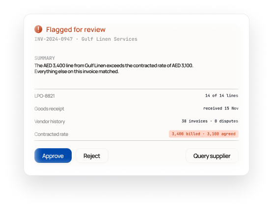
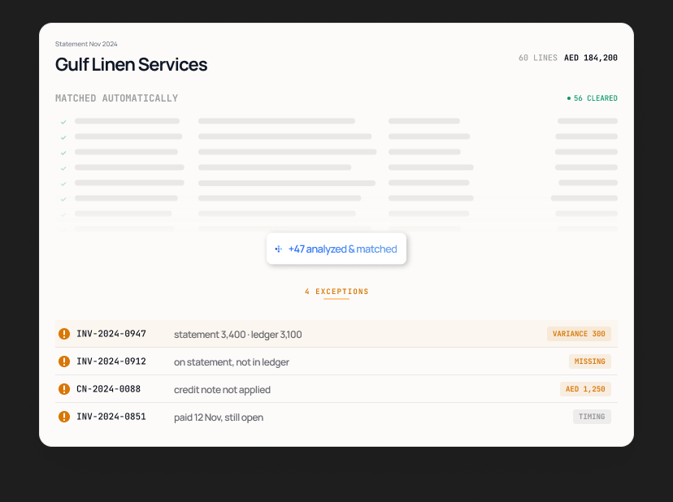
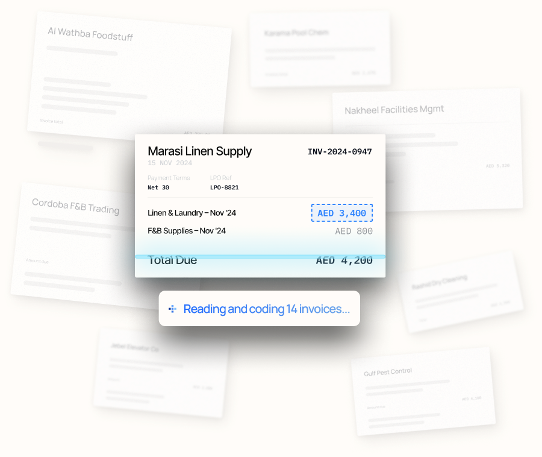
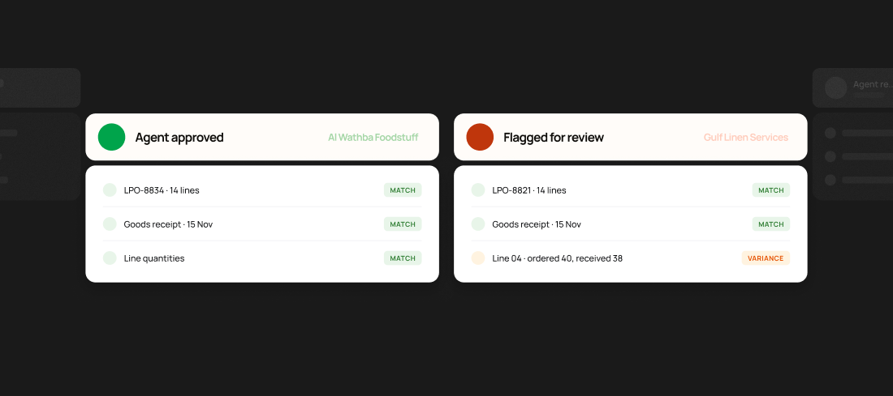
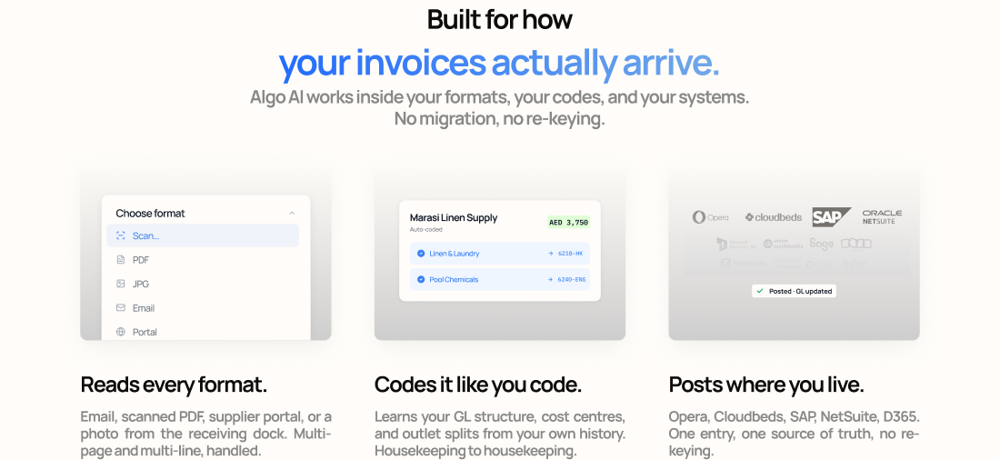

# Product visuals — how they work and how to make another

Every illustration on this site is a coded replica of a drawing in the brand
file (kept by the company's designer; ask the owner for access). None is an image, none is
invented. This document is the spec for adding one: read it before touching
`src/components/product/`. An agent definition that follows it lives at
`.claude/agents/product-visual.md`.

Internal document; nothing here ships to the site.

## 1. Why the drawings work

These are the properties to preserve. If a new visual loses one of them it
will look like a generic diagram again, however exact its pixels are.

1. **A moment of real work, not a diagram of a process.** Each visual is one
   frame of the product doing one thing: an invoice mid-scan, a statement with
   56 lines cleared and 4 held, a card asking for a decision. No boxes, no
   arrows, no "AI" iconography.
2. **Specific data.** `INV-2024-0947`, `3,400 billed · 3,100 agreed`,
   `received 15 Nov`. Specificity is what makes it read as a product. Data is
   set in the mono face; language is set in the sans. Never swap those roles.
3. **One focal element; everything else recedes.** The focus gets the only
   saturated colour in the frame (the dashed blue box, the orange tag, the red
   highlight). Everything around it is withdrawn on purpose: skeleton bars
   instead of text, 70% opacity, blur, a fade toward the bottom edge.
4. **Depth from very few cues.** One long soft shadow, a white rim inside the
   card edge, ghost cards behind the front one, a grey "well" that a piece of
   UI floats in. No gradients on the UI itself.
5. **Semantic colour as a whisper.** Status is saturated text on a ~10% tint
   of itself, at 8–11px. Never a filled badge, never a coloured card.
6. **The agent has one voice.** The paper pill with the five-square mark, its
   label in the blue gradient, written as what the agent is doing right now
   ("Reading and coding 14 invoices...").
7. **Cropping implies more.** Lists run off the bottom of a well, ghost cards
   run off the frame. The visual is a window onto something larger.
8. **Small type, set tight.** 8–14px, −0.04 to −0.05em tracking, hairlines at
   0.5px in night at 8%. Radii are 14 (card), 10 (control), 3 (tag).

## 2. The examples

| Reference (brand file render) | Node | Component | Stage width |
|---|---|---|---|
|  | `1:17365` | `ApprovalCard.tsx` | 460 |
|  | `1:17563` (+ menu `1:16843`) | `StatementPanel.tsx` | 732 |
|  | `1:16223` | `InvoiceScatter.tsx` | 1094 (print scale) |
|  | `1:17712` | `VerificationCards.tsx` | 1440 (650 stacked) |
|  | `1:16357` | `Well.tsx` + `FormatWell` / `CodingWell` / `SystemsWell` | 560 |

**Drawn by the site, not in the brand file.** `RetrievalCard.tsx`,
`AuditTrailCard.tsx` and `DataTiersCard.tsx` (content in
`src/content/product/governance.ts`) have no source frame: the brand file
covers accounts payable only, and the governance section makes three claims it
has no drawing for. They are built from the same parts, tokens and proportions
(460 wide, the pill above the card) and should be treated as drafts for the
designer to redraw. The rule that produced them: **the visual shows exactly
what the sentence beside it says, in the sentence's own words, and nothing
else.** The audit card's four tags are the four nouns in its sentence.

The hero invoice has a second state (`hero-a` / `hero-b` in `motion.css`):
after the band reads it, the same card gains its GL codes. That is also the
site's, extrapolated from the brand file's coding card.

**Drawn from the product dashboard (28 Oct 2026).** `PurchaseRequests`,
`InvoiceChecks`, `CollectionsList` and `CashTiming` follow screenshots of the
product dashboard (or, for the last two, its language where it has no such
screen), measured by eye. They share `Dash.tsx` (chips, agent note, check
marks, step bars), data in `src/content/product/dashboard.ts`, tokens in
`src/app/product/dashboard.css`. Each has a stacked Stage at 340 for phones.

`ExceptionsPanel.tsx` (`1:17818`, 378) and `AgentPill.tsx` follow the same
pattern. `ApprovalCard.tsx` is the reference implementation: copy its
conventions.

## 3. Anatomy

```
src/components/product/<Name>.tsx     server component, named export, zero strings
src/content/product/<name>.ts         every string and number drawn, `as const`, plus `alt`
src/app/product/<name>.css            only if the drawing needs a colour no token has
```

**The Stage.** `<Stage width={W} maxScale={M} label={alt}>` where `W` is the
width of the brand-file frame. Inside it, Tailwind's spacing unit is one brand-file
pixel, so the component is written in the drawing's own numbers and scales as
one piece:

| Drawing | Code |
|---|---|
| padding 22 | `p-22` |
| height 26, gap 8, width 350 | `h-26 gap-8 w-350` |
| x = 412 | `left-412` (or `left-[calc(var(--u)*412.5)]`) |
| font size 10 | `fs-u-10` |
| radius 14 | `rounded-u-14` |
| tracking −0.5px at 10px | `tracking-[-0.05em]` |
| shadow 0 20 48 | `shadow-[0_calc(var(--u)*20)_calc(var(--u)*48)_0_rgb(10_14_26/0.14)]` |

A frame drawn at print scale (the brochure pages, ~2.56× web) needs no
conversion: use its own width as `W` and a `maxScale` below 1.

A Stage carries `data-theme="light"` and is one `role="img"` to assistive
tech, described by `alt`.

**Dark.** The brand file draws light only. In the dark page theme every token
a visual uses is remapped in one place, `src/app/product/dark.css`, keyed off
`html[data-theme="dark"]` so it out-ranks the Stage's own attribute. Because
components only ever use token classes, a new visual gets its dark version by
adding its new tokens to that file: surfaces step up toward the viewer
(well → card → floating pill), status stays saturated text on a whisper of its
own colour, and values are mixed from the light ones rather than invented.
Check every new visual in both themes.

**Interaction and motion.** A visual may work, not just sit there, when using
it explains the product: the approval card takes a decision, the exceptions
panel recomputes its held total, the statement menu resolves its exception,
the format list's selection travels. Rules, all in `src/app/product/motion.css`:

- Gate first. One interaction per visual, and only if it demonstrates the
  claim the visual makes. Decoration is not a reason.
- A visual with controls is `<Stage interactive>` (a labelled group; an image
  hides its buttons from assistive tech), its controls are real `<button>`s
  with `aria-pressed`, every one is reversible, and its `alt` starts "Try it:".
- Reuse the classes: `ui-press` (140ms press), `ui-hit` (hover tint, fine
  pointers only), `ui-swap` (changed text eases in; key the element on the
  value), `ui-menu` (leaves and returns from its origin), `ui-selection` (a
  travelling highlight), `ui-decision`.
- Two curves only, `--ease-out` and `--ease-in-out`; never `ease-in`, never
  `scale(0)`, never `transition: all`. UI feedback stays under 300ms.
- `transform` and `opacity` only. State changes that alter text do not
  animate layout: the words change, the box does not grow.
- Transitions for anything a visitor can trigger twice in a second; CSS
  keyframes only for predetermined loops (the scan band, the agent mark).
- Reduced motion keeps the state change and its fade and drops the travel.

## 4. Procedure

1. **Find the frame.** Prefer a standalone web-scale frame over the same thing
   on a brochure page. Ignore frames named `Image (…)` or `Container (…)`:
   they are reference scrapes of other sites, not brand assets.
2. **Pull exact values** from the design tool's inspect panel (or its design-context export) on the
   frame, then on its children. Read positions from the layer list.
   Effects (blur, some shadows) are missing from design context; read them
   from the node. Never measure from a screenshot.
3. **Write the content file first.** Replace every supplier name with a
   fictional, non-UAE one (see `src/content/product/` for the names already
   in use, and reuse them so the visuals tell one story). Keep document
   numbers, dates and AED amounts as drawn.
4. **Build in a Stage**, top to bottom, in the drawing's numbers.
5. **Colours.** Use an existing token when the hex matches (`globals.css`
   tier 1 and the `--ui-*` block, then `src/app/product/*.css`). Only if none
   does, add `--algo-ui-<role>` plus its `--color-ui-<role>` to a partial,
   named by role. Check the name is not already taken with a different value.
6. **Icons** are Material Symbols in the Sharp style, through
   `src/components/product/Icon.tsx` (inlined paths, `currentColor`). Use them
   in place of the brand file's glyphs, which are inconsistent and in places
   do not render. To add one, follow the note at the top of that file.
7. **Preview** on a throwaway route `src/app/dev/<name>/page.tsx`, measure in
   the browser, delete the route before committing.
8. **Mark hooks for motion** with data attributes (`data-ghost`, `data-scan`,
   `data-select`, `data-pill`, `data-ptr`). Build static first and get it
   measured; add interaction second, following "Interaction and motion" above.

## 5. Things that will bite you

- `text-u-10` silently disappears: tailwind-merge reads an unknown `text-*` as
  a colour and drops it when a real text colour follows. It is `fs-u-10`.
- `fs-u-*` and `rounded-u-*` only exist in steps of 0.25. For 23.333 write
  `text-[length:calc(var(--u)*23.333)]`.
- The design tool measures padding from the frame edge and strokes take no space. With a
  1px border, padding is `calc(var(--u)*22 - 1px)`, or use an inside outline.
- A design-tool layer blur of radius R is CSS `blur(R/2)`.
- A fixed-height frame may clip its own content (the approval card clips a
  12px spacer). Match the frame, not the sum of its children.
- An em-based tracking value inherits as a computed length. Restate tracking
  on any child with a different font size.
- A nested piece drawn at another size (the pill, the action menu) overrides
  `--u` AND `--spacing` on its own root. See `AgentPill.tsx`.
- Two partials must not define the same token name. The later import wins and
  the earlier visual quietly changes colour.
- A sequence that changes content (the hero's invoices) is a small state
  machine setting `data-phase`, with every visual change in CSS keyed off it.
  Let a finished thing leave before the next arrives, pause it off screen and
  in a hidden tab, and never start it under reduced motion.
- To resize something to its text without animating layout, make it as wide
  as its widest state and close it with `clip-path` (see `.hero-pill-body`);
  put its shadow on a wrapper as a `drop-shadow`, which follows the clip.
- Layer names in the brand file are not reliable (several logos are labelled
  as each other). Name things by what the asset shows.
- The brand file uses Inter and IBM Plex Mono in places. The site loads
  Manrope and JetBrains Mono only: pin line heights to the drawn values so
  nothing shifts.
- A drawing made for a dark canvas (the verification cards' ghosts) will not
  survive a light page. Give the component a prop to drop what does not
  translate rather than inventing replacement colours.
- A wide composition becomes unreadable on a phone. Below ~0.5× scale, offer a
  `stacked` arrangement in a narrower Stage and switch with `hidden lg:block`.
- The repository sits in a synced folder that duplicates files inside `.next`
  (`routes.d 2.ts`). If `tsc` reports duplicate identifiers, run
  `find .next -name "* 2.*" -delete`.

## 6. Done means

- [ ] Rendered at the Stage's design width, every block is within 2px of its
      brand-file position and size, measured in the browser and converted back to
      design px.
- [ ] Type sizes, weights and tracking match; no hex or rgb brand colour in
      the component; no string in the component.
- [ ] Fictional non-UAE supplier names; amounts and numbers as drawn.
- [ ] Looks right in the dark page theme: any new token has a dark value in
      `src/app/product/dark.css`, and nothing is hard-coded white or black.
- [ ] No horizontal overflow at 360px; smallest type is legible at the size it
      ships (≥ 10px on desktop).
- [ ] `npx tsc --noEmit`, `npm run lint` and `npm run check:contrast` pass.
- [ ] The dev preview route is deleted.
- [ ] A report: files, new tokens (name → hex → role), anything not
      replicated and why. Deviations are fine; silent ones are not.
